# OpenGarageMusic

A music studio for Windows, written from scratch in Rust: record, play software
instruments, arrange, mix, and extend it with plug-ins. Its source is published and
it is free for personal use; a professional use needs a licence from the author
(see [Licence](#licence)).

### At start-up

A loading screen shows, for two seconds at least, while the program opens the sound
card, the latest session and the sound banks.

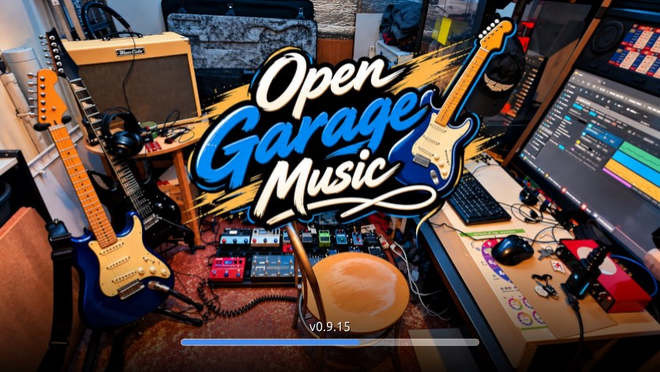

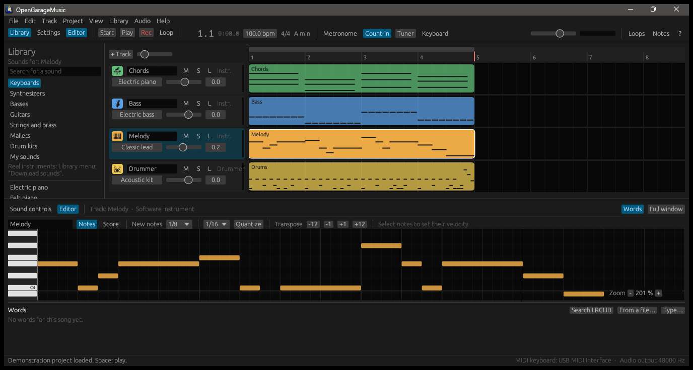

OpenGarageMusic is inspired by the features of GarageBand. It is an independent
project with no link to Apple: no code, sound, loop, image or text from Apple is
used, and nothing was decompiled. See the [rules of the project](docs/en/contributing.md).

*Documentation en français : [docs/fr](docs/fr/README.md).*

## What it does

| | |
|---|---|
| **Tracks** | Software instruments, audio, guitar or bass through an amp, a virtual drummer, a master track; each header shows the pictogram of the instrument the track plays, in the colour chosen with a click on it |
| **Sounds** | 36 built-in sounds set with knobs, an arpeggiator, SoundFont (`.sf2`, `.sf3`) and SFZ sampled instruments |
| **Editors** | Piano roll, score (key and time signatures, beams, rests, triplets), tablature with chord grids, slides, bends and the other techniques for guitar and bass tracks, both over one line, two lines or the whole window, for one track or several at once (or one at a time with auto-switch); beats chosen with Shift and a click, played in a loop; audio (pitch and timing), drummer; a sideways zoom without end (-, the value, +), effects automation |
| **Recording** | Computer keyboard, MIDI keyboard, microphone or line input with takes, count-in, metronome, tuner |
| **Loops** | 42 loops of notes that follow the tempo and the key, dragged from the browser into the tracks; your own recordings as audio loops, stretched to the tempo |
| **Mixing** | Equaliser drawn as a curve with points to drag, compressor, echo and reverb per track (a room or a plate), amps and eleven pedals, automation, an output of its own for any track |
| **Captures and impulse responses** | A capture of a real amplifier or pedal (Neural Amp Modeler, Proteus, AIDA-X) in place of the amp's drive stage, an impulse response for its cabinet and another for the reverb; your own files, or downloaded from TONE3000 (with your account) and GuitarML; none is shipped |
| **Plug-ins** | CLAP, LV2 and VST3 effects and instruments, each in a process of its own |
| **Original sound** | A song played with its recording, at its pace: an audio file of yours, found in step with the score, or the YouTube video Songsterr's users put in step with the tablature; your other tracks over it if you like |
| **Words of the song** | Under the editor, the line being sung or the whole text scrolling: the words of the tablature (Songsterr, Guitar Pro, MusicXML) syllable by syllable, words timed line by line from LRCLIB, or your own |
| **MIDI Pilot** | The songs of a concert in a window of their own, one large button each over its album cover: choosing one sends its preset number by MIDI to a pedal switcher (The GigRig G3S) and opens its project, found in your sessions or on a tablature site |
| **Files** | A project in one file (an archive of its JSON and its takes), saved in your documents, recent projects, the last projects you worked on kept as previous sessions without your saving them; import WAV, MP3, AAC, MIDI, and a recording of the song found in step with the score; a new project from a tablature of Songsterr, Guitariff or Tablature Hub (or of a site you describe yourself in a small JSON file), from a Guitar Pro file (GP3 to GP8, .gpx included) or from a MusicXML score; export WAV, AIFF, MP3, AAC, and MIDI for the notes |
| **Audio devices** | Output of all the tracks, input and its channel in the Audio menu; an output, an input and a channel of its own for any track |
| **Languages** | English, French, German, Spanish, Italian, Portuguese |
| **Themes** | The program's own look, a dark one, a light one, and yours: a theme is a small JSON file |
| **Quick help** | The “?” button tells what the pointer is over |

The full list, with what is done and what is not, is in
[Features](docs/en/features.md).

## A look around

### Sound controls

Every sound is shaped with a few knobs. The panels can be dragged into rows,
hidden and shown again, and the whole area can take the window when more room
is wanted.

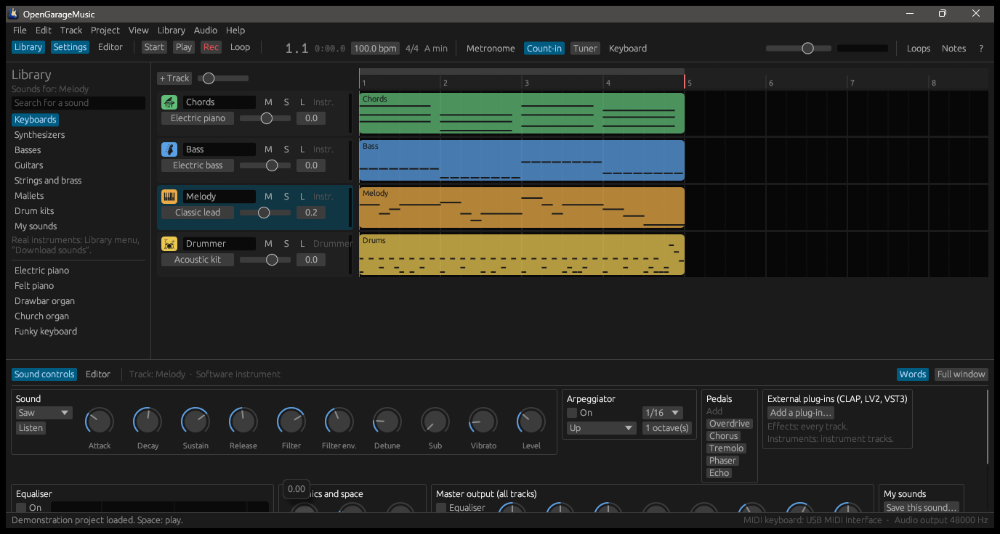

### Themes

The colours come from a small JSON file. Three themes are built in — here the
light one — and [your own can be imported](docs/en/themes.md).

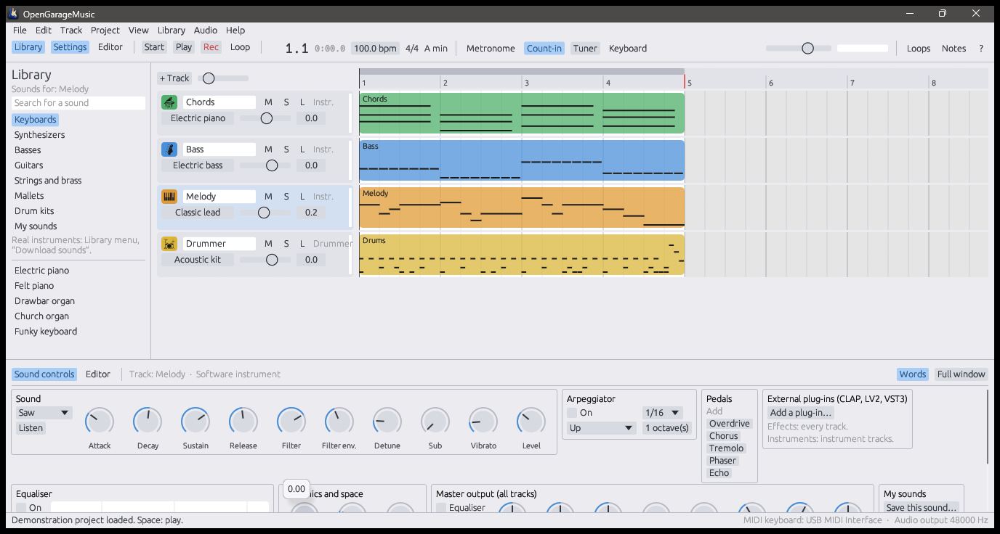

### Virtual drummer

A drummer track plays by itself: choose a style, then move one dot between
simple and complex, soft and loud.

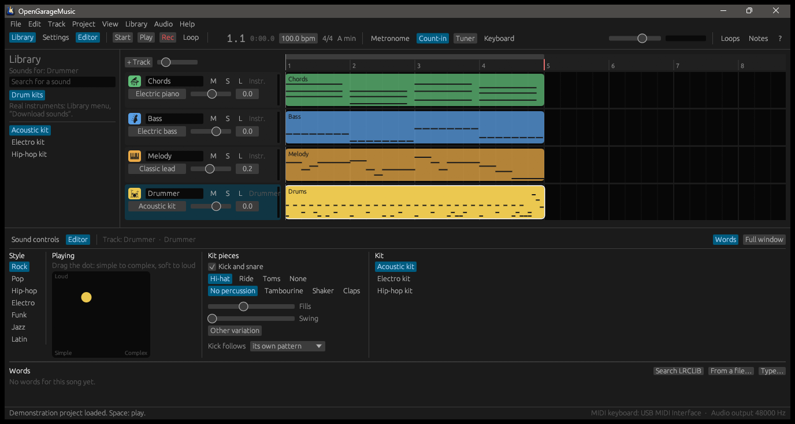

### Score

The notes of a region can be read and edited as a score as well as in the piano roll:
key and time signatures, beams, dots, triplets and rests, and the techniques a
tablature writes. The score and the tablature can run over two lines of bars, or over
the whole window line after line, following the song.

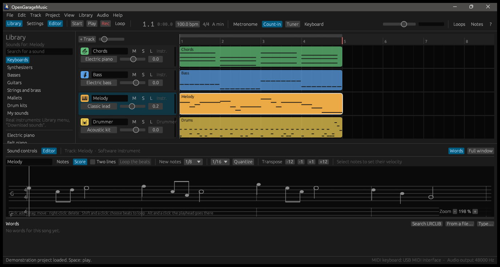

### Tablature, for several tracks at once

A guitar or bass track is read as a tablature, with chord grids and the techniques
written around the notes (slides, bends, hammer-ons, vibrato, palm muting, tremolo picking, trills, swing, let
ring…). Ctrl and a click on track headers put several tracks in the editor, one under
the other; “Auto-switch” shows them one at a time, the one being played. The text
size is yours to choose, and the fret numbers never run into one another. Shift and a
click on the beats of the score or the tablature choose a passage, which the “Loop the
beats” button plays over and over to practise it.

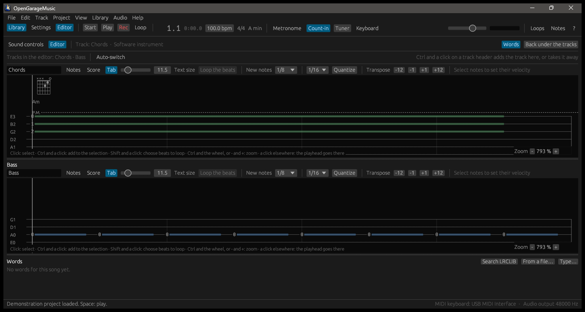

### Tablature sites, Guitar Pro and MusicXML, and the sites of captures

File → “New from a tablature site…” searches Songsterr, Guitariff or Tablature
Hub, lists the tracks of the song chosen, and makes a project of the ticked ones,
with their tuning, tempo, sections and techniques. Each site is described by a small
JSON file, so [other sites can be added](docs/en/sites.md). Guitar Pro files (GP3 to
GP8, .gpx included) and MusicXML scores become projects the same way, from the File
menu or dropped onto the window, with the words of the song when they hold them.

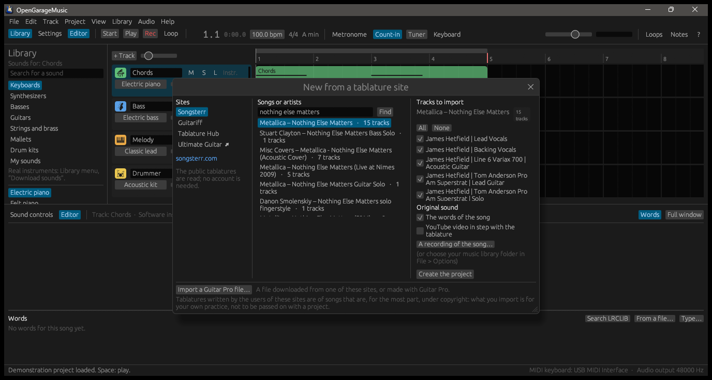

### Original sound: the recording and the video

A song can be played as written, at the tempo of the score, or with its original
sound: the “Original sound” button of the transport bar switches between the two at
any time. With the original sound, the song follows the pace of its recording, bar by
bar, even when the band speeds up or drags; the recording is heard, and the other
tracks are silent unless you turn off their M to play them over it.

The recording is a track of its own. It can be an audio file of yours (MP3, OGG, FLAC,
M4A/AAC, WAV): File → “Import into this project…” → “A recording of the song…”, and
the program finds by itself, in a couple of seconds, where the beats of the score fall
in it, and says how alike the two are. When you choose a folder as your music library
(File → Options), the recording of a song chosen on a tablature site is looked for
there and offered. Nothing is uploaded and the file is not copied.

Or it can be a YouTube video: for a song of Songsterr, ticking “YouTube video in step
with the tablature” brings the video with the second each bar starts at, as the site's
users set them. YouTube's own player plays it in step with the song. When the site has
several videos of the song, a list in the editor of the video track plays another
instead. The video shows
in the editor; with Ctrl and a click on the header of a guitar track, its tablature
shows under the video. Nothing is downloaded: the program keeps no video and none of
its sound.

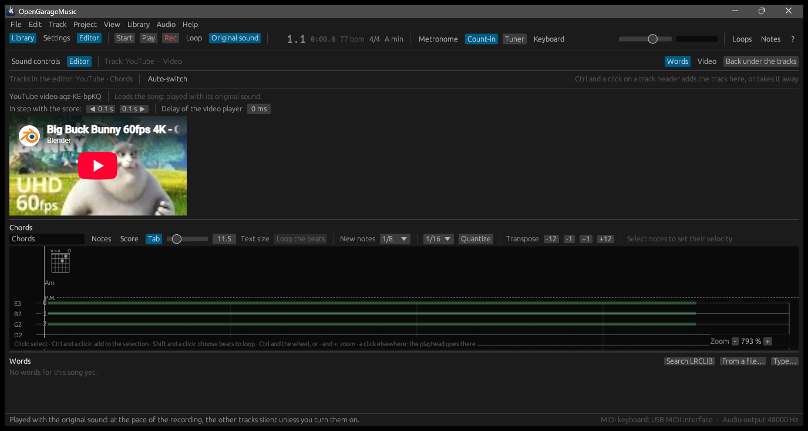

*The video in the picture is Big Buck Bunny, © Blender Foundation, under the CC BY 3.0
licence ([peach.blender.org](https://peach.blender.org)).*

### The words of the song

The “Words” button of the bottom panel shows the words of the song under the editor:
the line being sung, large, with the syllables already sung lit, the line before and
the line after; or, chosen in View → “Words of the song”, the whole text, scrolling to
the line being sung. A click on a line takes the song there. The words come from the
tablature when it has them (Songsterr, Guitar Pro, MusicXML), each syllable on its
note; otherwise from [LRCLIB](https://lrclib.net), a free base of words timed line by
line; otherwise from you: an LRC or text file beside your recording, a file you
choose, or words you type. They are kept in the project, for your own practice: like
tablatures, words are mostly under copyright.

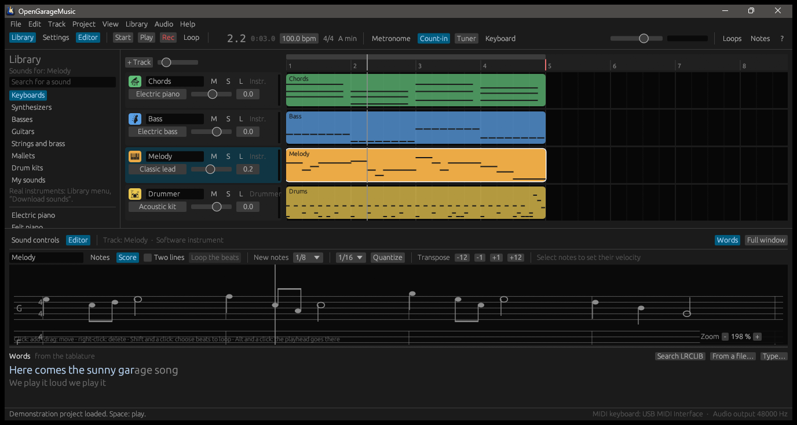

*The words in the picture were written for the demonstration project.*

### MIDI Pilot

File → “MIDI Pilot…” opens, in a window of its own that can go on a second screen, the
songs of a concert or a rehearsal, one large button each, over the cover of its album.
The list comes from a CSV file (number, artist, song, and the text of the button,
optional) or is written song by song. Choosing a song sends the number of its preset by
MIDI to a pedal switcher such as The GigRig G3S, or to an effects unit, and, when you
ask for it, opens its project. That is the switcher's mode; in the chain's mode, the
computer drives every MIDI pedal itself: each song carries its own messages (program
changes, control changes, system exclusive) for the devices of the chain, each on its
channel, written in the song or read from extra columns of the CSV file named after the
devices. The BOSS DD-500 and RV-500 pedals have a module of their own (Devices →
“Configure…”): their patches edited parameter by parameter and heard at once, stored in
the pedal, their program change map and system settings, all saved in a file and sent
back, the backups of the BOSS editor read too. The GigRig G3S has its module as well:
a backup file of the switcher loaded, its banks, presets (loops, their order, name, MIDI
messages) and names edited, a bank a song of the list, and the file written for the
switcher's editor to restore. An AI can do the programming for you: List → “Guide for
an AI…” writes the guide that teaches it the pedals and a small JSON format (also
`ai-guide.md` in the archive, and [docs/en/ai-guide.md](docs/en/ai-guide.md) for this
version of the code; the guide says which version wrote it); you give the guide and your wish to your AI (“my memory
50C of the RV-500 for Comfortably Numb”), and apply the script it answers with List →
“Apply an AI script…”, after a review of each action. List → “Export the pedalboard for an
AI…” gives the AI everything first: your chain, which pedals sit in which loops of the
switcher, your songs, the G3S backup and every memory known of the pedals. An agent of an AI running on your
computer (Claude Code, a script) can do it by itself through a local API (Settings →
“API for an AI…”: a port on `127.0.0.1`, a token, and your Yes in the window before each
write unless you allow unattended writes). On stage, `MidiPilot.exe` opens this window alone, without
the rest of the program; a song whose project is to be opened then starts the whole
program on it. A right-click on a song gives it a picture of your own
or a project, or finds its project: in your previous sessions, or on a tablature site,
where you choose the tablature. “Find the projects of the whole list” prepares a
concert in one go, the projects saved to be opened on stage without the Internet.

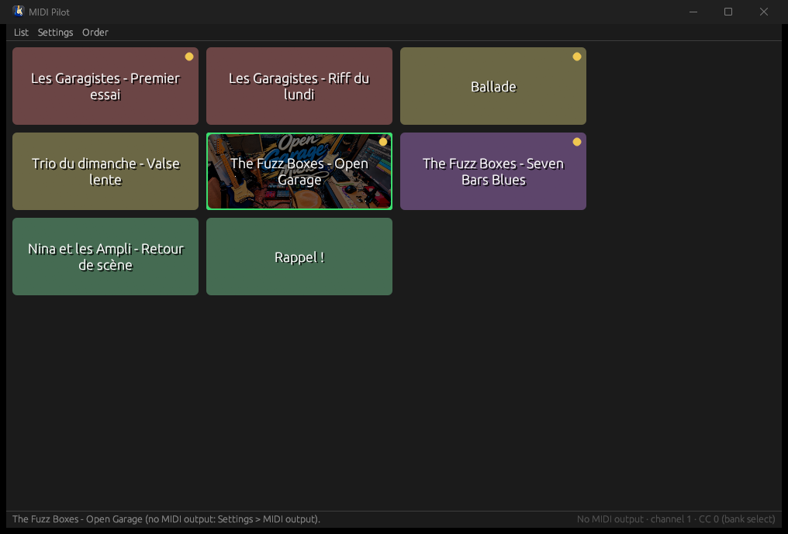

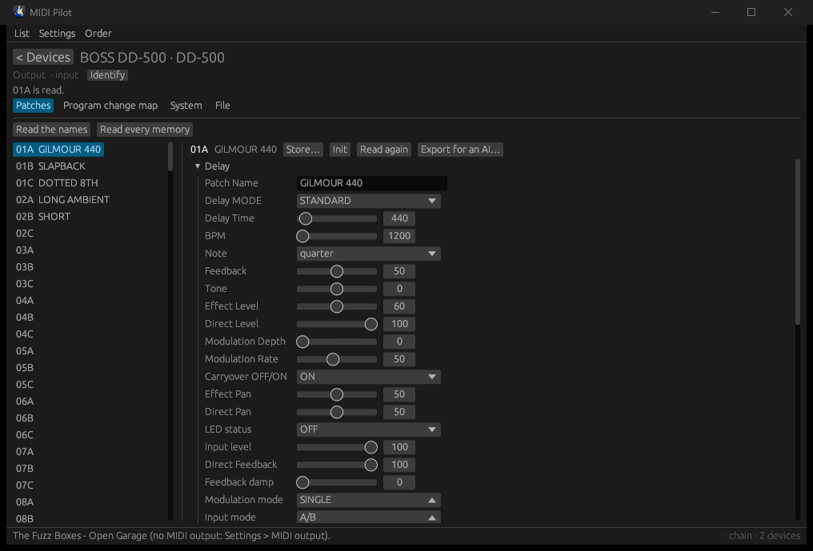

*The module of a BOSS DD-500, on a pedal made up for the picture: its memories, the patch chosen with its parameters by group.*

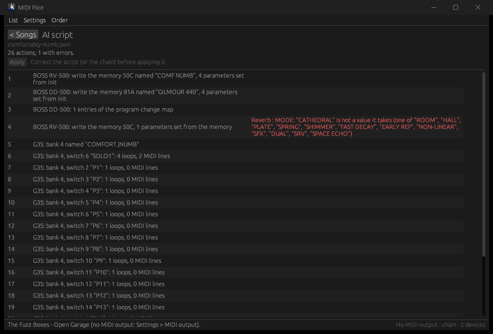

*A script an AI wrote, reviewed action by action before anything is written.*

*The songs and the artists in the picture were made up for the demonstration.*

### Previous sessions, import and export

The program keeps the last projects you worked on (20 by default, from 5 to 100),
saved or not, with their takes and the arrangement of the window, without your
saving anything. File → “Previous sessions…” lists them, the latest first, by artist
and title, length and date, and reopens one with a double-click. “Import into this
project…” adds an audio file or the tracks of a MIDI file; “Export to…” makes a WAV,
AIFF, MP3 or AAC file of the song, or a MIDI file of its notes as they are played.

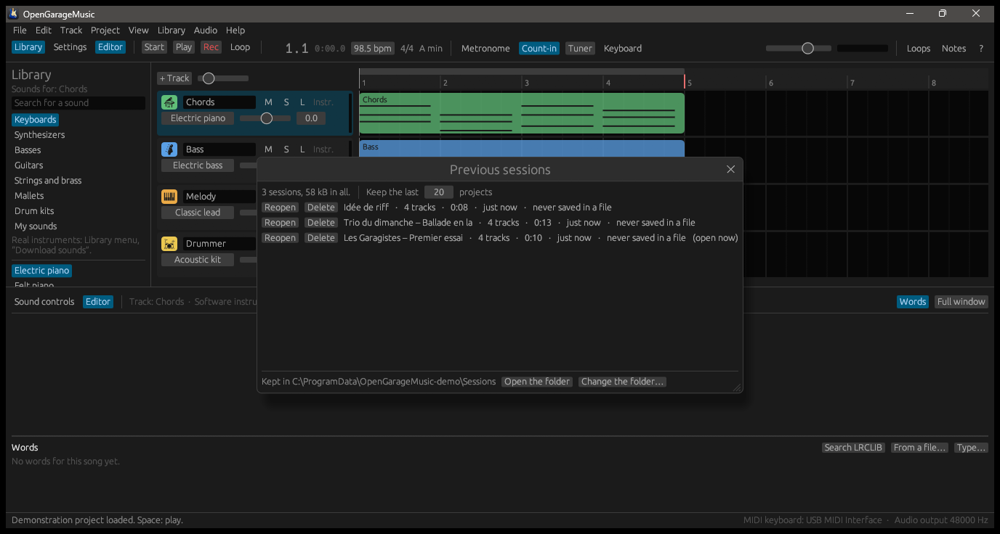

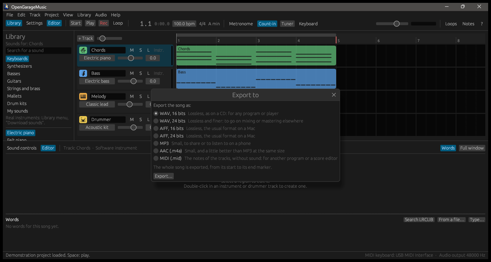

### Loops

Loops are filtered by instrument, genre and mood, listened to, and dragged into
the tracks. They follow the tempo and the key. Your own recordings can be added
as audio loops; none is shipped.

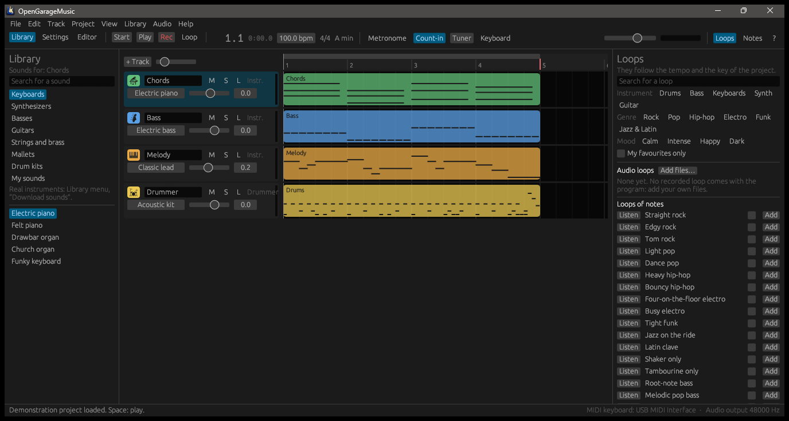

### Arrangement and automation

Tempo and transposition have tracks of their own, sections move with what they
hold, and volume and pan are drawn on each track.

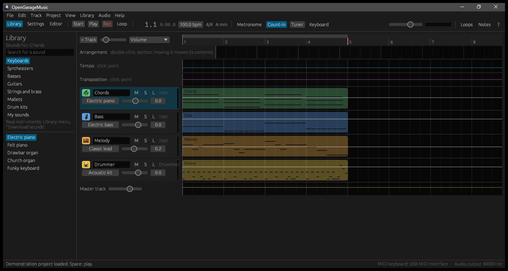

### Sounds and plug-ins on demand

No sound bank and no plug-in is shipped. The download window lists what a few
sites offer under a free licence, says where each item comes from, and marks
what is already on the disk.

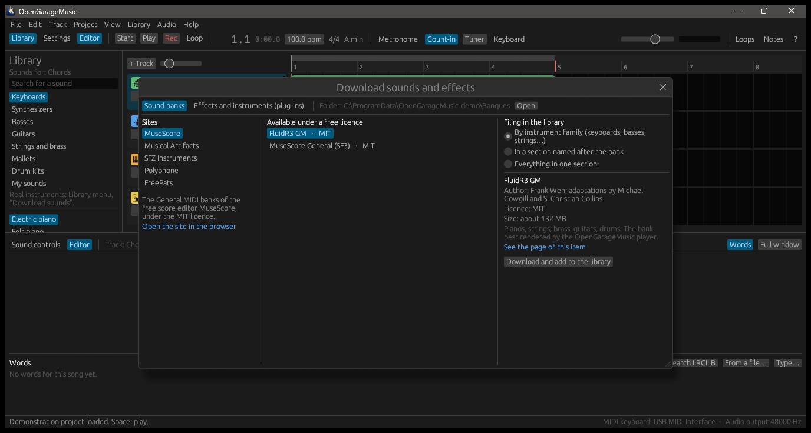


## Plug-ins

| Format | Supported |
|---|---|
| CLAP | effects and instruments, sliders, the plug-in's own window, state saved in the project |
| VST3 | effects and instruments, sliders, the plug-in's own window, state saved in the project |
| LV2 | effects and instruments, sliders, the plug-in's own window when it has one for Windows, state saved in the project |

Each plug-in runs in a process of its own: if it crashes, the track goes on
without it, the project stays open, and the plug-in can be started again. This
protects the program from a faulty plug-in; it is not a security barrier.

## Getting it

Download the archive of the latest version from the **Releases** page of this
project, unpack it anywhere, and start `OpenGarageMusic.exe`. Nothing is
installed; the program needs Windows 10 or 11, 64 bits. The `sites` folder next to
the program holds the descriptions of the tablature sites. `og-video.exe` and
`WebView2Loader.dll` (Microsoft's, under the BSD licence) are the video player, in a
process of its own: it uses the WebView2 web view that is part of Windows 10 and 11,
and the program starts without them; only the video does not. The video is played with the mouse: the keyboard always stays
the program's. A loading screen shows
while it opens the sound card, the latest session and the sound banks.

The program keeps the last projects you worked on as they are, saved or not, and
brings the latest back at the next start, with the window as you left it. That, the
audio devices and the language are set in **File → Options**, the **Audio** menu and
**View → Language**.

## Building it

Everything needed is installed inside the project folder, nothing on the system:

```
powershell -ExecutionPolicy Bypass -File tools\setup-toolchain.ps1
dev test --workspace
run
```

| Command | What it does |
|---|---|
| `run` | builds the program and starts it |
| `dev test --workspace` | runs the tests |
| `powershell -ExecutionPolicy Bypass -File tools\package.ps1` | makes the archive of a release in `dist` |
| `powershell -ExecutionPolicy Bypass -File tools\screenshots.ps1` | takes the pictures of this page again |

## Documentation

| | English | Français |
|---|---|---|
| Overview and shortcuts | [README](docs/en/README.md) | [LISEZ-MOI](docs/fr/README.md) |
| Features and known gaps | [Features](docs/en/features.md) | [Fonctionnalités](docs/fr/features.md) |
| Origin and licence of external files | [External files](docs/en/external-files.md) | [Fichiers externes](docs/fr/external-files.md) |
| Rules of the project | [Contributing](docs/en/contributing.md) | [Contribuer](docs/fr/contributing.md) |
| Adding or correcting a language | [Translating](docs/en/translating.md) | [Traduire](docs/fr/translating.md) |
| Making a theme | [Themes](docs/en/themes.md) | [Thèmes](docs/fr/themes.md) |
| Describing a tablature site | [Tablature sites](docs/en/sites.md) | [Sites de tablatures](docs/fr/sites.md) |
| What was asked for next | [To do](docs/en/todo.md) | [À faire](docs/fr/todo.md) |

## State of the project

Version 0.9.21. New in it: the pedalboard described in the MIDI Pilot (the pedals in
each loop of the switcher, the order of the signal, the bank switches), what the pedal
modules read kept between sessions, and one file that gives an AI the whole pedalboard
(“Export the pedalboard for an AI…”, `GET /pedalboard`). Version 0.9.20 brought the
licence, PolyForm Noncommercial 1.0.0 (free for personal use, a licence from the author
for professional use), with `LICENSE.md` and `COMMERCIAL.md` in the archive. Version
0.9.19 brought, all in the MIDI Pilot: the chain's mode, where each song
sends its own MIDI messages to the devices of your chain; modules that configure the
BOSS DD-500 and RV-500 over MIDI (every parameter of a patch, the program change map,
the system, files saved and sent back) and The GigRig G3S through its backup file
(banks, presets, loops, MIDI); scripts an AI writes from a guide the program itself
writes (`ai-guide.md`), reviewed before they touch anything, exports in the same format,
and a local API for an agent on your computer. Version 0.9.18 brought a project in one
`.ogproj` file (an archive holding its JSON and its takes), saved in the
`OpenGarageMusic` folder of your documents or where the options say, the takes no region
plays any more forgotten at save; the Set List named MIDI Pilot, and `MidiPilot.exe`
that opens that window alone for the stage.
Version 0.9.17 brought captures of real amplifiers and pedals (Neural Amp Modeler,
Proteus, AIDA-X) and impulse responses of cabinets and rooms in the effects of a
track, downloaded from TONE3000 and GuitarML through the window of the sites or brought
by you, six pedals more (noise gate, wah, auto-wah, flanger, tape and analog echoes) and
a plate reverb. Version 0.9.16 brought a take that never allocates in the audio
callback, the plug-in processes talking over a local socket, and the code lighter after
a review. Version 0.9.15 brought the zoom of the note editors without end, as
pixels a beat kept from one track and one song to the next, and eleven faults found
by a review of the code corrected ("Save as" into another folder, CLAP plug-in
windows, the MIDI Pilot…).
Version 0.9.10 brought the MIDI Pilot (the songs of a concert in a window of their own,
each sending its preset number by MIDI to a pedal switcher and opening its project),
the choice among the videos of a song, Stop that stops a video started from YouTube,
and the keyboard that stays the program's while a video plays. Version 0.9.9.1 brought
the original sound of a song (a recording of yours found in step with the score, or the
YouTube video Songsterr puts in step with the tablature), the words of the song under
the editor and the previous sessions. The program is tested by about 250 automated
tests, which drive the real interface without a screen. It has been tried very little with real
hardware and real third-party plug-ins: expect rough edges there, listed under
“Known gaps” in [Features](docs/en/features.md).

## Licence

OpenGarageMusic is published under the **PolyForm Noncommercial License 1.0.0**
([LICENSE.md](LICENSE.md)). In short:

- **Personal, non-commercial use is free**: you may use the program, read its code,
  change it and share it, for yourself, a band, a school, a charity, research, as long
  as the licence and the author's name stay with it.
- **Any professional or commercial use needs a licence from the author**: using it in
  a business, selling it, or building a product or a service on it. See
  [COMMERCIAL.md](COMMERCIAL.md) for how to ask.
- **Contributions are welcome**, by merge request; a contributor gives the author the
  rights on what they contribute, so that the whole program can be licensed as one
  (see [Contributing](docs/en/contributing.md)).
- This is **not an open-source licence** in the official sense, since it restricts
  commercial use: say "source available, free for personal use".

The libraries built into the program and their licences are listed in
[External files](docs/en/external-files.md). The pictograms of the tracks are drawings of
[Game Icons](https://game-icons.net) (CC BY 3.0), by Caro Asercion, Delapouite, Lorc,
Skoll and Zajkonur.
